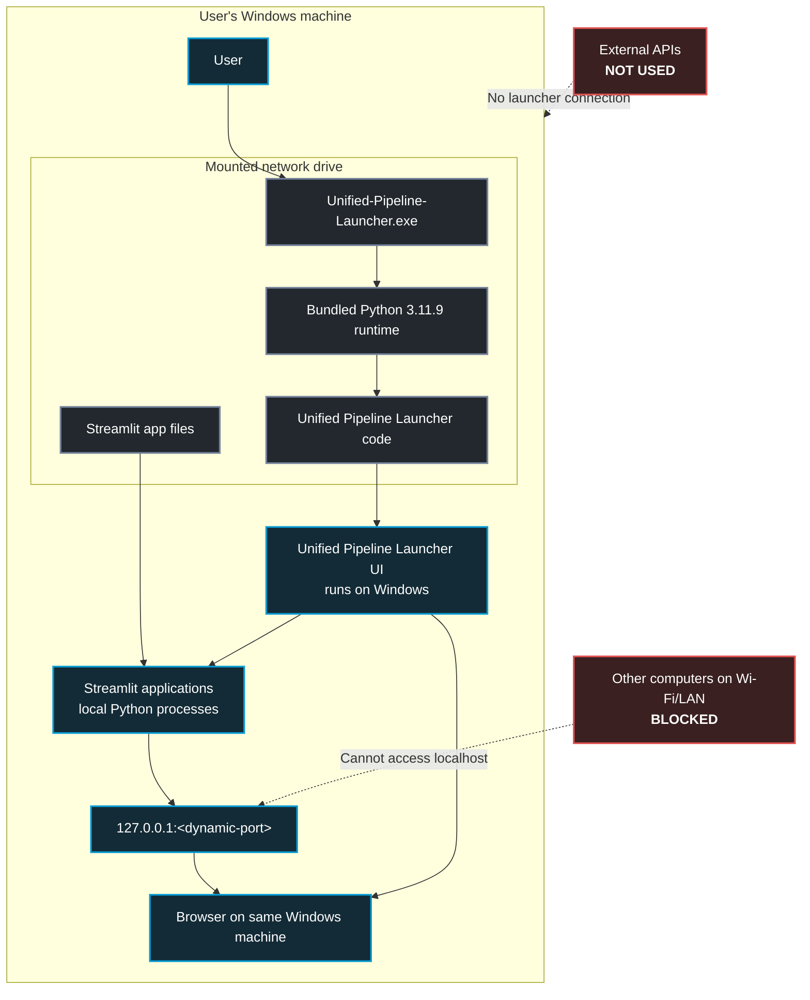
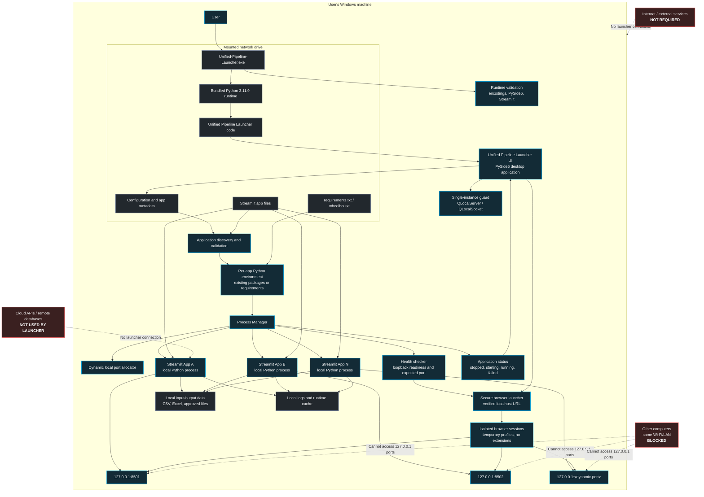

<p align="center">
  
</p>

# Unified Pipeline Launcher

Unified Pipeline Launcher is a Windows desktop application for starting,
viewing, restarting, and stopping local Streamlit applications from one screen.

Public repository: [Unified-Streamlit-Launcher](https://github.com/vinayvaida27/Unified-Streamlit-Launcher)

> **Open source:** released under the [MIT License](src/LICENSE). Contributions are
> welcome; see [CONTRIBUTING.md](CONTRIBUTING.md),
> [CODE_OF_CONDUCT.md](CODE_OF_CONDUCT.md), and [SECURITY.md](SECURITY.md).

This repository contains public demonstration applications only. Do not commit
laboratory, patient, credential, or other sensitive data.

## Requirements

- Windows 10 or 11
- Microsoft Edge
- Git or GitHub CLI
- Internet access during the first installation and package updates
- Write access to the installation folder

A separate Python installation is not required.

For Git Bash, WSL, or a Linux/macOS development checkout, `src/install.sh` is a
small convenience wrapper. It requires Python 3 on `PATH` and installs the
launcher requirements plus each non-template app's `requirements.txt`:

```bash
./src/install.sh
```

Windows users should double-click `install.bat`; it prepares the supported
portable runtime, builds `Unified-Pipeline-Launcher.exe`, and starts it.

## First-Time Installation

Clone the repository and run the installer:

```powershell
gh repo clone vinayvaida27/Unified-Pipeline-Launcher
Set-Location ".\Unified-Pipeline-Launcher"
.\install.bat
```

Git can be used instead of GitHub CLI:

```powershell
git clone https://github.com/vinayvaida27/Unified-Pipeline-Launcher.git
Set-Location ".\Unified-Pipeline-Launcher"
.\install.bat
```

You can also open the cloned folder in File Explorer and double-click
`install.bat`. The installer:

1. Downloads a portable Python runtime.
2. Installs the launcher and enabled applications' packages.
3. Builds `Unified-Pipeline-Launcher.exe` from the bundled runtime.
4. Starts the launcher.

`install.bat` remains available for repairs or repeat installation.

## Daily Use

- Double-click `Unified-Pipeline-Launcher.exe` for normal use.
- Use `Unified-Pipeline-Launcher-debug.bat` for diagnostics and repair.
- Use `diagnose_launcher.bat` for console diagnostics and executable repair.
- Open **Settings** and choose **Scan and update Python packages** to inspect,
  install, retry, or diagnose application dependencies.
- Select **Open** for one app or **Open All** for all visible apps.
- Closing the launcher stops apps that it started.

`Unified-Pipeline-Launcher.exe` is the canonical Windows entry point. It starts
the bundled `src\runtime\pythonw.exe` with the launcher module and resolves its
configuration relative to the executable directory.

Startup resolves paths from the installation folder, clears inherited Python
configuration, and validates the bundled interpreter's own standard library.
Source-tree module startup uses `-E -s -m launcher` from the trusted source
directory. Isolated `-I` probes validate the runtime separately; `-I -m launcher`
would lose the source directory needed for package discovery.

Normal portable network launches use the verified bundled runtime without
copying the entire runtime or application tree before showing the window.
The canonical entrypoints pass only arguments supported by the Python launcher
CLI. Explicit cache operations remain available through configuration/direct
invocation. Existing local
installed deployments keep their runtime local; a network source must never
become that runtime's Python prefix. Maintenance does not automatically switch
between these deployment modes.

The launcher opens apps in an isolated Microsoft Edge Guest window with browser
extensions disabled. App servers bind only to `127.0.0.1`, use Streamlit's CORS
and XSRF protections, and are stopped when the launcher exits. Startup also
removes identity-matched processes left by an earlier crash. Normal app launches
run the bundled Python directly; dependency tools are not invoked when an app is
opened.

## Pull Updates

Close the launcher and its apps before updating. Open PowerShell in the cloned
repository and run:

For the original release line, the equivalent command is `git pull --ff-only origin main`.

```powershell
git pull --ff-only
.\update_package.bat
```

`git pull` updates the currently checked-out branch without hard-coding `main`.
`update_package.bat` bootstraps the project's pinned `uv` tool when needed,
updates the portable runtime and recognized virtual environments, rebuilds the
branded launcher, refreshes its shortcut, and reports failed checks. Maintenance
installation requests `--link-mode=copy` so the local uv cache also works with
mapped/UNC destinations.

The Settings package updater scans registered app imports, maps common import
names to their distribution names, checks the bundled runtime, and installs
missing packages one at a time. It uses a local pip cache with retries,
timeouts, and binary preference before writing into the shared runtime. A
network runtime must be writable; failed package details are shown in Settings
and saved under the local package cache for retry and diagnosis.

Shared-runtime maintenance holds an exclusive updater lock and prepares a
complete sibling candidate. It validates the candidate, retains the old runtime
as `runtime.previous-<id>`, activates the replacement, and validates the final
path. Failed activation attempts restore the prior directory. A missing
`*.dist-info/RECORD` triggers a fresh Python base and a full requirements install
inside staging for the selected release. Windows console scripts are generated
with the final interpreter path so they survive activation.

Close affected apps for every user of a shared deployment and allow space for
the candidate and retained backups. The two directory moves are not one atomic
transaction; keep the reported previous-runtime path for recovery. Development
and app virtual-environment updates still run in place. A failed development
sync no longer automatically clears and rebuilds that environment.

Start the launcher again after both commands finish.

### Pull code updates without reinstalling Python

When the domain PC already has a validated `src\runtime`, pull source changes
and run the diagnostic repair flow. This does not
download Python or reinstall packages:

```powershell
git pull --ff-only origin development/codex-launcher-v2
& .\Unified-Pipeline-Launcher-debug.bat
```

Use `Unified-Pipeline-Launcher-debug.bat` when the runtime or executable needs
repair. Run `install.bat` again for a complete installation.

The equivalent maintenance entry point for a shell is:

```bash
./src/update_dependency.sh
```

The `ECC` branch contains the current reliability work. Its
[release report](docs/ecc/release-report.md) lists executed checks, unresolved
acceptance work, and a guarded manual update procedure. Local tests do not
establish corporate SMB or local installed-runtime acceptance.

## Add An App

Application folders live directly under `apps`. Copy the included template:

```powershell
Copy-Item -Recurse .\apps\app_template .\apps\my_app
```

Update these files:

- `apps/my_app/app.py`: the Streamlit entry point
- `apps/my_app/requirements.txt`: all Python dependencies
- `apps/my_app/assets/icon.svg`: the launcher icon
- `apps/apps.json`: the application registry

Add an entry to the `applications` array in `apps/apps.json`:

```json
{
  "id": "my-app",
  "name": "My App",
  "folder": "my_app",
  "description": "A short description shown in the launcher.",
  "category": "General",
  "version": "1.0.0",
  "display_order": 11,
  "enabled": true,
  "icon": "assets/icon.svg"
}
```

### App registry and archive state

`apps/apps.json` is strict JSON and is the only runtime registry. Each
application may set `archived` to `true` or `false`; omitted values inherit the
default `false`. Archived apps are hidden from **All applications**, but remain
available in the **Archived** category for restore. The launcher updates this
single field atomically when Archive or Restore is selected; it does not move
app folders or delete app data.

JSON cannot contain comments, so the field-by-field commented example lives in
[`apps/apps.template.jsonc`](apps/apps.template.jsonc). Copy its shape into
`apps/apps.json` while keeping the file valid JSON.

An app does not need a folder under `apps`. Use `path` or `app_path` for a
direct Streamlit file path, or `project_path` for a project folder. Paths may
be absolute or relative to `apps/` or the repository parent:

```json
{
  "id": "my-external-app",
  "path": "D:/shared/pipelines/my_app.py",
  "requirements_path": "D:/shared/pipelines/requirements.txt",
  "icon_path": "D:/shared/pipelines/assets/icon.svg",
  "name": "Shared Pipeline",
  "version": "1.0.0",
  "description": "A Streamlit file stored outside this repository.",
  "category": "External",
  "display_order": 12
}
```

For a project folder, `app_path` defaults to `project_path/app.py`. The
launcher checks an explicit `requirements_path`/`requirements` first, then
`requirements.txt` or `requirement.txt` in the project. An explicit
`icon_path`/`icon` is handled the same way; otherwise it checks the project's
assets and falls back to the Unified Pipeline Launcher icon. A missing
requirements file creates `.launcher-requirements.txt` from unique third-party
imports in the entrypoint (standard-library modules and Streamlit are skipped),
so the existing per-app environment installer can install them. The entrypoint
must still be a real `.py` file; loopback binding, process supervision, and
isolated browser rules remain unchanged.

Bump `version` whenever the app's dependencies or behavior changes. To add a
dependency and refresh the runtime:

```powershell
.\src\scripts\update_dependencies.ps1 -Target app -AppId my-app -Package "plotly>=5,<6"
```

Commit and push the app folder and `apps/apps.json`. In other installations,
use the commands in **Pull Updates**, then restart the launcher.

Application SVG icons are validated by the public quality gate. If a local or
untracked SVG is malformed, the desktop UI falls back to the application's first
letter instead of repeatedly rendering invalid SVG path data.

## Project Structure

```text
Unified-Pipeline-Launcher/
|-- apps/                       App registry and Streamlit apps
|-- install.bat                 First-time installer and repair entry point
|-- Unified-Pipeline-Launcher.exe  Normal Windows launcher
|-- Unified-Pipeline-Launcher-debug.bat  Repair and diagnostics
|-- diagnose_launcher.bat        Console diagnostics and repair
|-- update_package.bat          Python environment updater
|-- README.md
`-- src/
    |-- config/                 Launcher configuration
    |-- launcher/               Desktop application
    |-- scripts/                Dependency, build, and release support
    |-- install.sh              Shell dependency installer
    |-- LICENSE                 Project license
    |-- tests/                  Automated tests
    |-- pyproject.toml          Dependency and package metadata
    `-- uv.lock                 Reproducible development/build lock
```

## Architecture context

The launcher files can live on a mounted network drive, while the UI,
Streamlit processes, and browser run on the user's Windows computer:

```text
User
  -> Unified-Pipeline-Launcher.exe on the mounted network drive
  -> bundled Python 3.11.9 and launcher code on that drive
  -> Unified Pipeline Launcher UI on Windows
  -> Streamlit apps as local Python processes
  -> 127.0.0.1:<dynamic-port>
  -> browser on the same Windows computer
```

The network drive contains `Unified-Pipeline-Launcher.exe`, the bundled runtime, launcher
source, and Streamlit app files. Execution stays on Windows: app servers bind
only to `127.0.0.1`, so other computers on the same Wi-Fi cannot open them.
The browser displays all Streamlit frontends locally. The launcher does not
require external APIs or cloud services.

Archive changes write only `archived` in `apps/apps.json` using a temporary
file and atomic replacement. Browser profiles are per-app temporary
directories and are cleaned up at stop, restart, or launcher exit.

Understand-Anything can generate `.ua/knowledge-graph.json` for deeper future
LLM exploration; this section is the stable human-readable context when the
graph is absent.

### Visual architecture

Simple architecture:



Complex architecture:



## Development

To convert an existing Python script into a launcher-managed Streamlit app, use
[SKILL.md](SKILL.md). It requires a concise five-question intake covering input,
output, workflow, parameters, and app/privacy details before code is changed.

Run the setup script once. It installs the pinned `uv` tool into the launcher's
local tools directory and synchronizes the locked Python 3.11/3.12 development
environment:

```powershell
.\src\scripts\setup_dev.ps1
```

The script prints the exact test command for its controlled `uv.exe`.
Developers who already have the pinned `uv` on `PATH` can use the standard workflow:

```powershell
uv sync --project .\src --locked --link-mode=copy
uv run --project .\src --locked --no-sync python -m pytest .\src\tests
```

`src/pyproject.toml` defines launcher and development dependencies,
`src/uv.lock` pins the complete development/build environment, and each
`apps/<app>/requirements.txt` remains the source for that app's packages.
`src/requirements-launcher.txt` is a generated compatibility export used when
preparing portable shared runtimes.

The optional `verification` group pins coverage, lint, security, browser-test,
and process-inspection tools. Install it only in the development environment:

```powershell
$Uv = & .\src\scripts\ensure_uv.ps1
if ($LASTEXITCODE -ne 0) { throw "Pinned uv setup failed." }
& $Uv sync --project .\src --locked --group verification --link-mode=copy
if ($LASTEXITCODE -ne 0) { throw "Verification environment setup failed." }
& $Uv run --project .\src --locked --no-sync python -m pytest .\src\tests
```

Offscreen Qt, native Windows entrypoint, and real SMB checks are separate test
categories. Native acceptance requires a disposable prepared deployment and
`ECC_ACCEPTANCE_ROOT`; normal hosted CI does not test the corporate share.
See [AGENTS.md](AGENTS.md) for the authoritative path, data-protection, and
verification requirements.

Run the public readiness checks from the repository root:

```powershell
.\src\scripts\public_quality_gate.ps1
```

## Contributing

Please start with [CONTRIBUTING.md](CONTRIBUTING.md). Pull requests should keep
the public apps and documentation free of sensitive data, include focused tests
for behavior changes, and preserve the documented runtime/path constraints.

## Security

Report a possible vulnerability privately using the process in
[SECURITY.md](SECURITY.md). Do not open a public issue containing credentials,
patient data, or an exploitable proof of concept.

## License

Copyright © 2026 vinayvaida27. This project is licensed under the
[MIT License](src/LICENSE).
